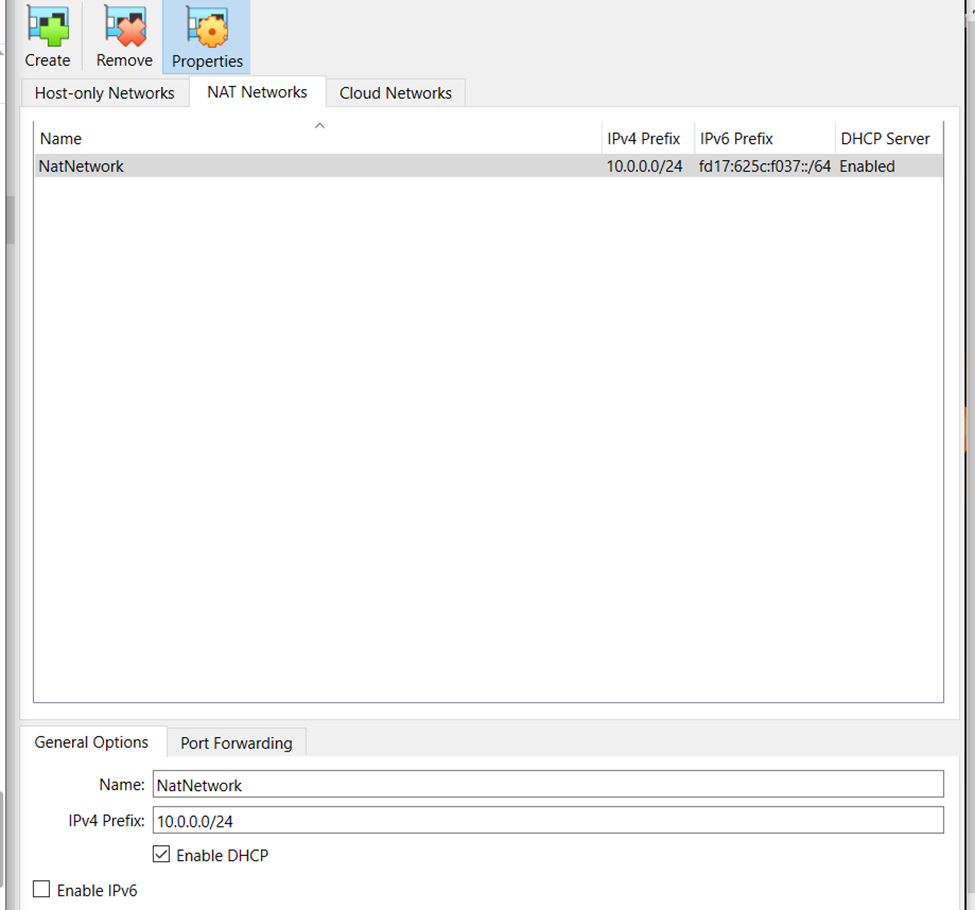
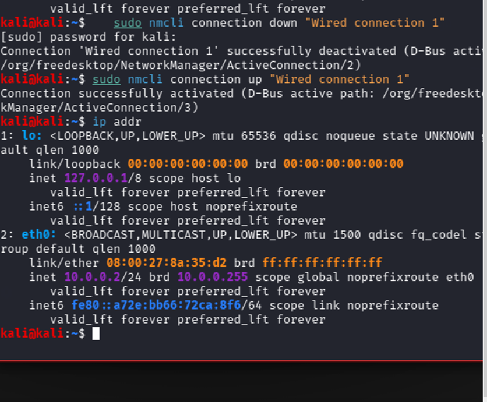
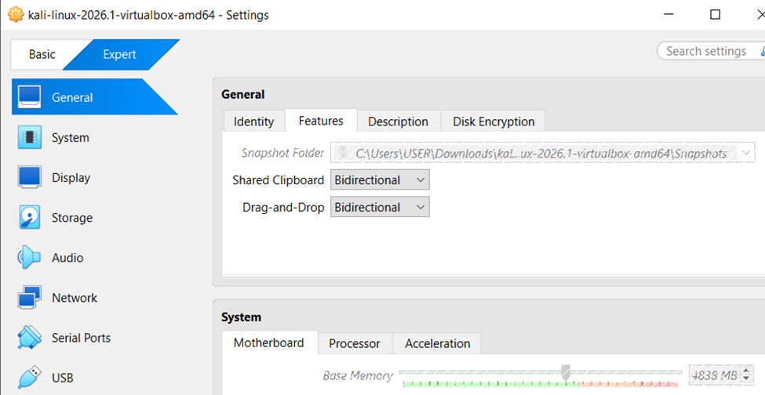
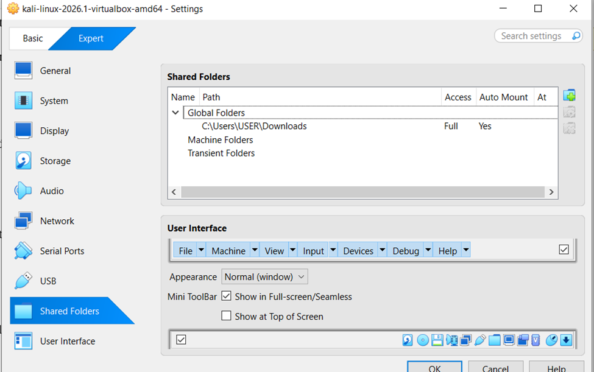
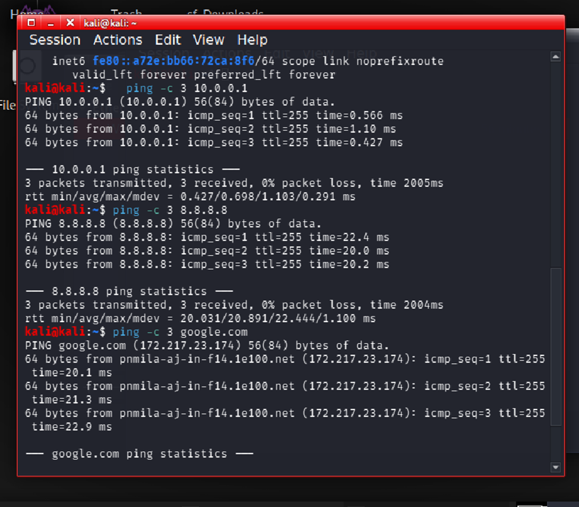
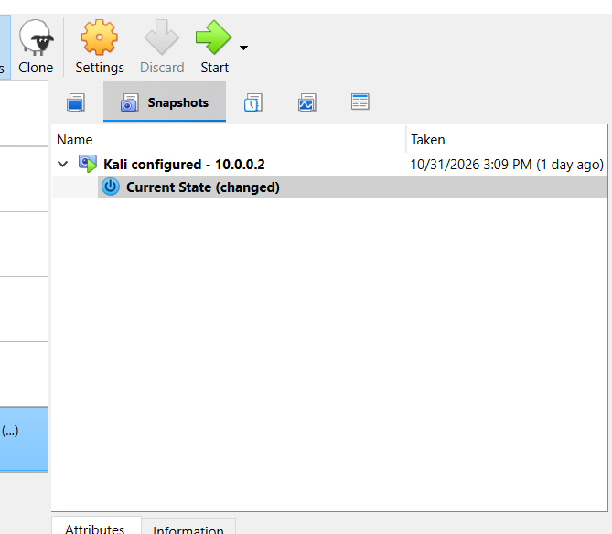

# B084-WK1-PM1-CYBERSECURITY-LAB-SETUP
Cybersecurity Lab setup

## 1. Project Overview

This project involved building a virtual cybersecurity lab environment using Oracle VirtualBox and Kali Linux, following the WK1-PM1 requirements provided by Networkwalks Academy.

The purpose of this project is to establish a controlled virtual environment for learning cybersecurity, ethical hacking, network configuration, and Capture The Flag (CTF) practical exercises.

## 2. Project Objectives

The main objectives of this project were:

- Install and configure Oracle VirtualBox.
- Download and import Kali Linux as a virtual machine.
- Create a custom NAT Network using the required subnet.
- Configure Kali Linux with the required static IP address.
- Enable bidirectional clipboard and drag-and-drop functionality.
- Configure shared folders between the host and virtual machine.
- Verify internet connectivity.
- Create a snapshot of the configured Kali Linux virtual machine.

## 3. Tools and Technologies

| Tool | Purpose |
|---|---|
| Oracle VirtualBox | Virtualization platform |
| 7-Zip | Archive extraction |
| Kali Linux 2026.1 | Cybersecurity testing machine |
| NAT Network | Virtual network configuration |

## 4. Lab Architecture and Network Configuration

A custom NAT Network named `NatNetwork` was created in VirtualBox.

The network was configured according to the assignment requirements.

| Setting | Configuration |
|---|---|
| Network Name | NatNetwork |
| Network Type | NAT Network |
| IPv4 Prefix | 10.0.0.0/24 |
| DHCP Server | Enabled |
| Kali Linux IP | 10.0.0.2/24 |
| Default Gateway | 10.0.0.1 |
| Network Interface | eth0 |

### NAT Network Configuration

The VirtualBox NAT Network was successfully configured using the required IPv4 subnet.



## 5. Kali Linux Virtual Machine Configuration

Kali Linux 2026.1 was successfully downloaded, imported, and configured in Oracle VirtualBox.

The virtual machine was connected to the custom NAT Network and assigned the required IP address.



## 6. VirtualBox Integration Settings

The required VirtualBox integration features were enabled:

- Shared Clipboard: Bidirectional.
- Drag and Drop: Bidirectional.
- Shared Folders: Enabled.
- Host Downloads folder shared with the virtual machine.

These settings allow easier interaction and file sharing between the host operating system and Kali Linux.

### Clipboard and Drag-and-Drop Configuration



### Shared Folder Configuration



## 7. Internet Connectivity and Testing

Internet connectivity was successfully configured and tested from Kali Linux.

The following commands were used to verify network connectivity and DNS resolution:

**Gateway connectivity:**

```bash
ping -c 3 10.0.0.1
```

**External IP connectivity:**

```bash
ping -c 3 8.8.8.8
```

**DNS resolution and connectivity:**

```bash
ping -c 3 google.com
```

All three tests were successful, confirming connectivity to the gateway, external network, and DNS resolution.



## 8. Troubleshooting

During the configuration process, a network connectivity issue was encountered.

The network connection was restarted using NetworkManager commands, and the IP configuration was checked again.

The following commands were used:

```bash
sudo nmcli connection down "Wired connection 1"
sudo nmcli connection up "Wired connection 1"
```

After the connection was restored, network connectivity was successfully verified using ping tests.

## 9. Virtual Machine Snapshot

After completing the Kali Linux configuration, a snapshot was created in VirtualBox.

The snapshot was named:

`Kali configured - 10.0.0.2`

This provides a restore point for the configured virtual machine and supports future practical exercises.



## 10. Lessons Learned

Through this project, I gained practical experience with:

- Virtual machine installation and configuration.
- Virtual networking and NAT Networks.
- IPv4 addressing and network interfaces.
- Linux network configuration using NetworkManager.
- Internet connectivity and DNS testing.
- Shared folders and VirtualBox integration features.
- Troubleshooting basic virtual network connectivity issues.
- Creating and managing virtual machine snapshots.

## 11. Conclusion

The WK1-PM1 Cybersecurity Lab Setup was successfully completed according to the assignment requirements.

Oracle VirtualBox and Kali Linux were installed and configured, the required NAT Network and IP address were established, and the integration features and shared folder were enabled.

Internet connectivity was tested successfully, and a snapshot of the configured Kali Linux virtual machine was created.

The virtual lab environment is now ready for future cybersecurity learning, ethical hacking practice, and CTF challenges.

---

**Project:** B084-WK1-PM1 – Cybersecurity Lab Setup  
**Training Provider:** Networkwalks Academy  
**Virtualization Platform:** Oracle VirtualBox  
**Operating System:** Kali Linux 2026.1  
**Status:** Completed
